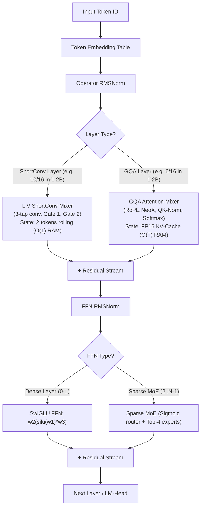

# LAII AI Agent Knowledge Hub (`aidocs/`)

Welcome to the **LAII Agent Knowledge Hub**! This directory is specifically designed for LLM agents (especially Google Gemini and advanced agentic coding systems) to rapidly orient themselves, understand the non-negotiable architectural invariants of the **Liquid AI (LFM2/LFM2.5) Inference Engine**, and safely contribute high-performance C11/SIMD code without introducing regressions or memory safety defects.

---

## 🗺️ Quick Navigation for Agents

| Document | Purpose | When to Read |
| :--- | :--- | :--- |
| [**`AGENT_PRIMER.md`**](file:///home/avisheks/Documents/python-projects/Python-projects/laii/aidocs/AGENT_PRIMER.md) | **7 Golden Rules**, mental models & agent instruction cheatsheet | **Read first** before writing or modifying any code |
| [**`ARCHITECTURAL_INVARIANTS.md`**](file:///home/avisheks/Documents/python-projects/Python-projects/laii/aidocs/ARCHITECTURAL_INVARIANTS.md) | Mathematical formulations, recurrent vs GQA state rules, MoE routing & prompt cache invariants | When designing new layers, caches, or state logic |
| [**`MEMORY_AND_STATE_MAP.md`**](file:///home/avisheks/Documents/python-projects/Python-projects/laii/aidocs/MEMORY_AND_STATE_MAP.md) | Arena layouts, zero-allocation rules, OOM guard formulas & HugePages | When managing buffers, tensors, or memory plans |
| [**`CODEBASE_TOPOLOGY.md`**](file:///home/avisheks/Documents/python-projects/Python-projects/laii/aidocs/CODEBASE_TOPOLOGY.md) | Complete directory tree, file responsibilities, symbols & dual-build structure | When locating code, headers, or test binaries |
| [**`SIMD_AND_KERNELS.md`**](file:///home/avisheks/Documents/python-projects/Python-projects/laii/aidocs/SIMD_AND_KERNELS.md) | AVX2/FMA/F16C vector routines, quantization layouts (`Q4_K`, `Q6_K`, `IQ4_XS`) & CPUID dispatch | When writing or optimizing vector kernels |
| [**`EXTENSION_PLAYBOOK.md`**](file:///home/avisheks/Documents/python-projects/Python-projects/laii/aidocs/EXTENSION_PLAYBOOK.md) | Step-by-step developer recipes for adding features, quantization formats, and test targets | When implementing new user requests |
| [**`COMMON_PITFALLS.md`**](file:///home/avisheks/Documents/python-projects/Python-projects/laii/aidocs/COMMON_PITFALLS.md) | Catalog of fatal traps, sanitizer bugs, alignment rules, and anti-patterns | Before running tests or finalizing changes |

---

## ⚡ What is LAII?

**LAII** (Liquid AI Inference) is a **zero-dependency, production-grade C11 inference engine** engineered from first principles for Linux x86_64 CPUs. It natively runs the **LFM2** and **LFM2.5** family of hybrid models (1.2B, 8B-A1B, 24B-A2B, and Thinking models).

### The Core Hybrid Mental Model:
Unlike standard Transformers (Llama, Mistral, Qwen) where 100% of layers are self-attention, **Liquid AI models replace most layers with Linear Input-Varying (LIV) Short Convolutions ($k=3$)**:



* **ShortConv Layers:** Maintain a tiny, constant $O(1)$ rolling state of only 2 tokens ($s_0, s_1$) per channel (~16 KB/layer). **No growing KV-cache!**
* **GQA Layers:** Traditional Grouped Query Attention capturing sparse long-range dependencies, storing FP16 Keys and Values in linear buffers.
* **MoE Layers (`lfm2moe`):** First two layers are dense SwiGLU; layers 2..$N-1$ activate Top-4 experts per token via an auxiliary-loss-free Sigmoid router with learned selection bias ($c_e = s_e + b_e$) and zero-copy 3D tensor slicing over `mmap`.

---

## 🛠️ Essential Commands Cheat Sheet

```bash
# 1. Compile and run all 27 automated unit, hardening, and numerical parity test binaries
make test-c-bins

# 2. Run the complete test suite including standalone tools, Python bindings, and HTTP server
make test

# 3. CRITICAL: Run memory safety verification under AddressSanitizer & UndefinedBehaviorSanitizer
make test-asan

# 4. Build and verify all 16 standalone statically linked ELF executables
make static-test

# 5. Run the high-level CLI executable with prompt cache and sequential page warmup
./lfm-run -m tests/lfm2_toy.gguf -p "Liquid AI Prompt" --warmup --prompt-cache prefix.lfmcache

# 6. Run modern Python SDK unit tests
python3 tests/test_python_lfm2.py

# 7. Run 5-tier numerical parity & contract verification suite
make test-parity

# 8. Run zero-dependency non-blocking epoll OpenAI HTTP/SSE server test
./bin/test_lfm2_server
```

> [!IMPORTANT]
> **Always run `make test-asan` before declaring any task complete.** The engine maintains a strict zero-leak, zero-overflow, zero-undefined-behavior standard. If ASan reports even 1 leak or alignment warning, the code is considered broken.

---

## 📜 License & Disclaimers

This project is licensed under the [MIT License](../LICENSE).

* **Independent Project:** This repository is an independent open-source inference engine developed by the community. It is not affiliated with, endorsed by, or sponsored by Liquid AI, Inc.
* **Weights:** Model weights are separate artifacts subject to the Liquid AI Community License and are downloaded by the end user from Hugging Face.


