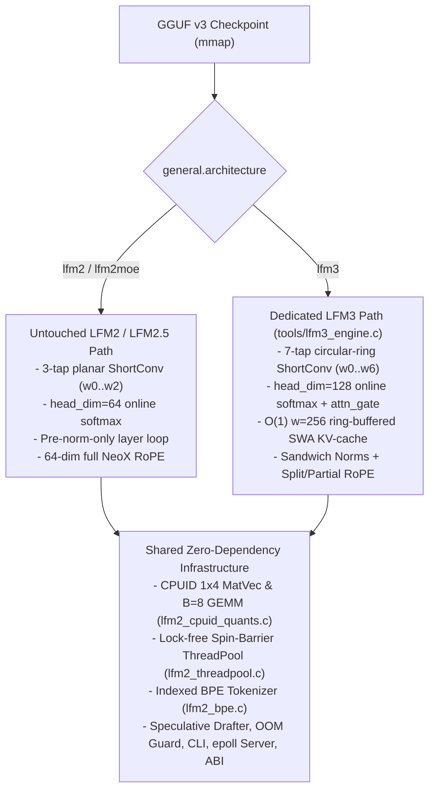

# LFM3 Isolated Integration & Optimization Implementation Plan

> **Core Architectural Guarantee:** LFM3 uses **separate, dedicated loader, state, and forward functions** (`lfm3_*`) and never alters LFM2 / LFM2.5 hot loops (`l_cache == 3` 3-tap planar ShortConv, `head_dim == 64` register-pinned FlashAttention-CPU, pre-norm-only layer loop). Architecture-agnostic SIMD quant kernels (`Q4_K`, `Q6_K`, `Q8_K`, `1x4` MatVec, `B = 8` batched GEMM, `LFM2ThreadPool`) are reused without duplication.
>
> For architectural background and empirical GGUF measurements, see [`LFM3_VS_LFM2_GUIDE.md`](LFM3_VS_LFM2_GUIDE.md).

---

## 1. Objectives & Design Architecture

### Design Principles & Non-Negotiable LAII Invariants
1. **Zero external dependencies:** Pure ISO C11 (`-std=c11`) + POSIX (`mmap`, `madvise`, `pthread`, `futex`).
2. **Zero dynamic allocations in decode loops:** All LFM3 ring buffers, `conv_w[7]`, SWA KV rings, RoPE LUTs, and scratch pads are preallocated at init and 64-byte aligned via `lfm2_aligned_alloc_64` (size rounded to a multiple of 64 for ASan).
3. **Zero LFM2 / LFM2.5 regression:** Keep `lfm2_forward_shortconv`, `lfm2_forward_gqa_fast`, `LFM2PlanarConvWeights`, and `lfm2_forward_batch` functionally unchanged.
4. **Multi-ISA parity:** Provide AVX2/FMA/F16C, ARM64 NEON/FP16, and scalar C11 fallbacks (`LFM2_FORCE_ISA=scalar`), plus dual `ne[4]` / `dims[4]` boundary cleanliness (`tools/` vs `src/`).
5. **Absolute sanitizer cleanliness:** `make test`, `make test-asan`, `make test-tsan`, `make static-test`, `make test-python`, and `make test-jni` must all pass.

---

## 2. Context Matrix: What Must Be Preserved Differently for LFM2/2.5 vs. LFM3

Keep these exact runtime invariants separated by architecture:

| Dimension | LFM2 / LFM2.5 (`lfm2`, `lfm2moe`) | LFM3 (`lfm3`, e.g. `LFM3-1.7B-Q4_K_M.gguf`) |
| :--- | :--- | :--- |
| **Layer Block Enum** | `SHORTCONV`, `GQA_FULL` (`head_count_kv[l] == 0` vs `> 0`) | `SHORTCONV` (`13`), `GQA_SWA` (`5` layers via `sliding_window_pattern[l] == true`), `GQA_FULL` (`6`) |
| **ShortConv History & Update** | `l_cache = 3` (`hist = 2`, `16 KB/layer` at `D=2048`), planar `w0..w2`, 2-slot `s0 <- s1, s1 <- u_t` | `l_cache = 7` (`hist = 6`, `48 KB/layer` = `624 KB` total), planar `w0..w6`, **circular ring index** `(ring_head + k) % 6` (zero `memmove`) |
| **Attention Head Geometry** | `head_dim = 64` (`H_q=32, H_kv=8` in 1.2B) | `head_dim = 128` (`H_q=16, H_kv=4` in 1.7B; read `attention.key_length` / `D / n_head_q`) |
| **KV-Cache Allocation** | Full linear `max_seq_len * kv_dim` per GQA layer (`12 KB/tok` in 1.2B) | Full layers: linear `max_seq_len * kv_dim` (`12 KB/tok`). **SWA layers:** fixed `min(max_seq_len, sliding_window + LFM2_MAX_BATCH)` ring (`256 + 8 = 264` slots = `528 KB/layer`, ~`2.6 MB` total!) |
| **Attention Output Gate** | None | `blk.i.attn_gate.weight` (`[2048, 16]` `Q4_K`) → `gate[h] = sigmoid(W_gate[h] · x_norm)` scales each 128-dim head output before `attn_output.weight` |
| **Layer Norms** | Pre-norms only (`attn_norm`, `ffn_norm`) | **Sandwich norms** on all 24 layers (`attn_norm`, `post_attention_norm`, `ffn_norm`, `post_ffw_norm`) |
| **RoPE Configuration** | Single `rope_lut` (`freq_base = 1e6`, full `64`-dim rotation) | Two LUTs: `rope_lut_swa` (`freq_base_swa = 10000`, full `128` dims) and `rope_lut_full` (`freq_base = 1e6`, partial `64` dims via `rope_freqs.weight` `[64]` where `[0..31]=1.0, [32..63]=1e30`) |
| **LM Head (`output.weight`)** | `[2048, 65536]` `Q6_K` (`105 MiB/tok`, `token_embd_norm.weight`) | `[2048, 128000]` `Q6_K` (`205.08 MiB/tok`, `output_norm.weight`) |
| **Tokenizer & BOS** | `65,536` vocab, `63,683` merges, `add_bos_token = True`, `< 64` specials | `128,000` vocab, `293,320` merges, `add_bos_token = False`, `3,107` non-normal tokens (`<think>`, `</think>`, `<|tool_call_start|>`, `<|img_row_*|>`) |
| **Speculative Rollback** | Restore `conv_trace[b][l]` + rewind `pos` (append-only KV cache is safe) | Restore `conv_trace[b][l]` + `conv_ring_head` + rewind `pos`; SWA ring size `256 + 8 = 264` prevents the 8-token draft batch from overwriting committed `[pos - 255 .. pos]` slots |
| **`LFM2Checkpoint` (`ctx.branch()`)** | Snapshots `conv_state` (`160 KB`) + `pos` + RNG ring (`< 15 µs`) | Snapshots `conv_state` (`624 KB`) + `conv_ring_head` + **all 5 SWA ring KV buffers** (`~2.5 MB`, ~150 µs) + `pos` + RNG ring, because arbitrary branching can overwrite SWA ring slots |
| **`.lfmcache` Prompt Cache** | Linear `conv_state` + `0..n_tokens-1` KV per GQA layer | Linearized `conv_state` (`[t-6..t-1]`) + `0..n_tokens-1` KV on Global layers + **last `min(n_tokens, 256)` slots** on SWA layers, with LFM3 geometry included in `model_fingerprint` |
| **KV Sink Shifting** | Shifts GQA `k_cache_f16`/`v_cache_f16` (`head_dim = 64`) and counter-rotates by `-n_discard`; ShortConv untouched | Shifts Global layers (`head_dim = 128`, counter-rotating only active partial RoPE dims); **SWA layers keep their ring window**, counter-rotating their `<= 256` valid K keys by `-n_discard` so `pos` stays unified |

---

## 3. Micro-Details & Traps Discovered in Existing Code

> [!WARNING]
> **Critical Bugs to Fix Before Any LFM3 Forward Pass Can Run:**
> 1. **Substring Collision in [`tools/lfm2_loader.c`](../tools/lfm2_loader.c) (`parse_lfm2_metadata_kv`):**
>    `strstr("lfm3.rope.freq_base_swa", ".rope.freq_base")` matches! Because `freq_base_swa = 10000.0` appears after `freq_base = 1000000.0` in `LFM3-1.7B-Q4_K_M.gguf`, the current loader silently overwrites `rope_freq_base` with `10000.0`.
>    Similarly, `strstr(key, ".attention.sliding_window")` would match `".attention.sliding_window_pattern"`.
>    **Fix:** Match exact key suffixes (e.g. helper `ends_with(key, ".rope.freq_base_swa")` checked *before* `ends_with(key, ".rope.freq_base")`, and exact `ends_with` for `.attention.sliding_window` vs `.attention.sliding_window_pattern`).
> 2. **SWA Ring Overwrite During `ctx.branch()` and Speculative Drafting:**
>    With a naive `256`-slot SWA ring buffer (`pos & 255`), speculative drafts (`B <= 8`) or `ctx.branch()` calls overwrite entries `pos - 256 ..` that are still needed if rejected or rolled back.
>    **Fix:** Allocate `SWA_RING_CAP = sliding_window + LFM2_MAX_BATCH` (`264` slots via `pos % s->swa_cap`) for speculative safety, and include SWA KV slabs inside `LFM2Checkpoint` for `ctx.branch()` (only when `n_swa_layers > 0`).
> 3. **Tokenizer `specials[64]` Overflow & $O(N \cdot 3107)$ Scan in [`tools/lfm2_bpe.c`](../tools/lfm2_bpe.c):**
>    `LFM3-1.7B` has `3,107` non-normal tokens (`token_type` 3/4), including `<think>` and `</think>` (which lack `<|...|>` brackets!).
>    **Fix:** Dynamically allocate `specials` when `tokenizer.ggml.token_type` marks control/user-defined tokens (plus `<think>`, `</think>`, `<|...|>`), and index specials with a 256-entry first-byte bitmap + length-sorted lookup table so text without `'<'` skips special scanning in $O(1)$.

### Mathematical Verification Gate (Phase 0 — Must Run Before Coding LFM3 Operators)
Before writing the LFM3 forward pass, verify against the reference (`LiquidAI/LFM3-1.7B` or `llama.cpp >= v0.8.0`):
1. **Sandwich Norm placement:** Confirm `x = x + post_attention_norm(op_out)` and `x = x + post_ffw_norm(ffn_out)` (vs. post-residual norm).
2. **Partial RoPE pairing:** Confirm whether LFM3 global layers pair `(x[i], x[i + rot_dim/2])` (`0..31` with `32..63`, leaving `64..127` untouched) or `(x[i], x[i + head_dim/2])` or interleaved `(2i, 2i+1)`.
3. **`attn_gate` input & shape:** Confirm `gate = sigmoid(attn_gate.weight @ x_pre_norm)` (sharing `xb` / `xq_scratch` with `Q, K, V`) scales each head output vector `o_h[0..127]` before `attn_output.weight`.
4. **Extract a `.lfm_golden` logit fixture** for a deterministic test prompt to drive automated Tier 5 parity checks.

---

## 4. Phased Implementation Plan

### Phase 0: Reference Extraction & LFM2.5 Baseline Benchmark
1. **Record baseline LFM2.5 throughput** on `models/LFM2.5-1.2B-Instruct-Q4_K_M.gguf` and `models/LFM2.5-350M-Q4_K_M.gguf` (`prefill tok/s`, `decode tok/s`, RSS) to verify zero regression later.
2. **Verify LFM3 reference math & generate golden logits:** Verify Sandwich Norm placement, partial RoPE pairing, `attn_gate` placement, and save a reference logit vector (`build/lfm3_ref.lfm_golden`) using `LiquidAI/LFM3-1.7B` / `llama.cpp`.

### Phase 1: GGUF Metadata & LFM3 Tensor Binding ([`tools/lfm2_loader.c`](../tools/lfm2_loader.c))
Keep LFM2 loading path untouched for `"lfm2"` / `"lfm2moe"`, and extend `LFM2Config` / `LFM2Layer` / `LFM2Model` cleanly with additive fields:
1. **`LFM2Config` additions** (zero impact when absent):
   - `bool is_lfm3;`
   - `uint32_t head_dim;` (explicitly read from `.attention.key_length`, fallback `n_embd / n_head_q`)
   - `uint32_t rope_dim;` (from `.rope.dimension_count`, fallback `head_dim`)
   - `float rope_freq_base_swa;` (from `.rope.freq_base_swa`, default `10000.0f`)
   - `uint32_t sliding_window;` (from `.attention.sliding_window`, `0` for LFM2)
   - `bool is_swa_layer[LFM2_MAX_LAYERS];` (from `.attention.sliding_window_pattern` GGUF bool array)
   - `int8_t add_bos_token;` (`-1` unset, `0` false, `1` true from `tokenizer.ggml.add_bos_token`)
2. **`lfm2_block_type_t` addition:**
   - `LFM2_BLOCK_SHORTCONV = 0`
   - `LFM2_BLOCK_GQA_ATTN  = 1` (Global Full GQA)
   - `LFM2_BLOCK_SWA_ATTN  = 2` (Sliding-Window GQA — helper `lfm2_layer_is_attn(b)` covers `== 1 || == 2`)
3. **Exact-suffix metadata parser fix in `parse_lfm2_metadata_kv`:**
   - Replace fragile `strstr` matches on `.rope.freq_base` and `.attention.sliding_window` with exact suffix matching (`lfm2_key_has_suffix`) so `.rope.freq_base_swa` and `.attention.sliding_window_pattern` never corrupt `.rope.freq_base` or `.attention.sliding_window`.
   - Parse `tokenizer.ggml.add_bos_token` (`GGUF_TYPE_BOOL`).
4. **Dedicated `bind_lfm3_tensors(LFM2Model *m)`** (called when `strcmp(m->cfg.arch, "lfm3") == 0`; `bind_lfm2_tensors` stays intact for `lfm2` / `lfm2moe`):
   - Binds global `rope_freqs.weight` (`[rope_dim / 2]` `F32`), `token_embd.weight`, `output_norm.weight`, and optional `output.weight`.
   - Binds `post_attention_norm.weight`, `post_ffw_norm.weight`, and `attn_gate.weight` on attention layers.
   - Marks `block_type = LFM2_BLOCK_SWA_ATTN` when `m->cfg.is_swa_layer[l]` is true, else `LFM2_BLOCK_GQA_ATTN` (when `n_head_kv[l] > 0`), else `LFM2_BLOCK_SHORTCONV`.
   - Updates `bin/lfm2_loader` CLI output to display `[GQA_SWA]` / `[GQA_FULL]` / `[SHORTCONV]`, `head_dim`, `sliding_window`, `freq_base_swa`, and `add_bos_token`.

### Phase 2: Scalable BPE Special Tokens & ChatML Handling ([`tools/lfm2_bpe.c`](../tools/lfm2_bpe.c))
1. Read `tokenizer.ggml.token_type` (`INT32` array) in `lfm2_vocab_load` and capture `bos_token_id` / `eos_token_id` / `padding_token_id`.
2. Replace `SpecialToken specials[64]` with dynamically allocated `SpecialToken *specials` (freed in `lfm2_vocab_free`), registering `token_type == 3 || token_type == 4` or `<|...|>` / `<s>` / `</s>` / `<unk>` / `<think>` / `</think>`.
3. Build a 256-entry first-byte index so plain text spans without special-token start bytes skip special scanning via `memchr`.
4. Verify tokenization & detokenization on `LFM3-1.7B-Q4_K_M.gguf` and re-run `bin/test_bpe`.

### Phase 3: Dedicated LFM3 State, Forward & SIMD Fast Kernels (`tools/lfm3_engine.c`)
Create a dedicated module **`tools/lfm3_engine.c`** (reusing `lfm2_loader.c`, `lfm2_cpuid_quants.c`, `lfm2_decode_1x4.c`, `lfm2_prefill_batch.c`, `lfm2_threadpool.c`) implementing LFM3 cleanly without altering LFM2/LFM2.5 fast paths:
1. **7-Tap Planar ShortConv with Circular Ring Buffer:**
   - `LFM3PlanarConv7` (`w[7][D]` 64-byte aligned), `6 * D` state floats (`48 KB/layer`), circular `conv_ring_head[LFM2_MAX_LAYERS]` (zero `memmove`), fused AVX2/NEON/scalar 7-tap pass (`Gate 1 -> 7-tap FMA -> Gate 2 -> L1-hot Q8_K`), and batched `B <= 8` speculative trace support.
2. **Hybrid SWA Ring-Buffer & Global `head_dim = 128` Online-Softmax Attention:**
   - SWA layers allocate `swa_cap = sliding_window + LFM2_MAX_BATCH` (`264`) FP16 K/V slots (`528 KB/layer`), indexed via `pos % swa_cap` and looped over `[max(0, pos - sliding_window + 1) .. pos]`.
   - Global layers allocate linear `max_seq_len * kv_dim` FP16 K/V caches.
   - Split/partial RoPE LUTs (`rope_lut_swa` full 128 dims at `10000.0`; `rope_lut_full` partial 64 dims at `1000000.0` driven by `rope_freqs.weight`).
   - Dedicated `128`-dim QK-Norm + RoPE + FP16 online softmax (16 `ymm` AVX2 accumulators / 2×64-dim zero-spill NEON tiles) + fused `attn_gate` (`16` rows in `Q4_K` sharing `Q, K, V`'s `Q8_K` input pass).
3. **Fused Sandwich Norm Layer Loop (`lfm3_forward_decode` & `lfm3_forward_batch`):**
   - `attn_norm` $\rightarrow$ Operator $\rightarrow$ `post_attention_norm` + residual + `ffn_norm` + `Q8_K` $\rightarrow$ `1x4` SwiGLU FFN (`n_ff = 7680 = 30 × 256`) $\rightarrow$ `post_ffw_norm` + residual.
4. **Standalone LFM3 Test & Golden-Logit Parity Gate (`tests/test_lfm3.c`):**
   - Scalar vs SIMD parity, `B = 8` vs `M = 1` parity, and `LFM3-1.7B-Q4_K_M.gguf` Tier 5 golden logit parity.

### Phase 4: Checkpoints, Prompt Cache, KV Sink Shifting & Speculative Decode Integration
1. **Hybrid Checkpoints ([`tools/lfm2_moe_checkpoint.c`](../tools/lfm2_moe_checkpoint.c)):**
   - Extend `LFM2Checkpoint` with optional `conv_ring_head[LFM2_MAX_LAYERS]` and optional `swa_kv_slab` (`NULL` for LFM2/LFM2.5 — zero memory/copy cost on LFM2).
2. **Prompt Cache & OOM Guard ([`tools/lfm2_sys_cache.c`](../tools/lfm2_sys_cache.c)):**
   - Count SWA layers as fixed `min(requested_ctx, sliding_window) * 2 * kv_dim * 2` bytes in `lfm2_plan_memory_and_guard_oom`.
   - Hash `sliding_window`, `is_swa_layer[]`, `rope_freq_base`, and `rope_freq_base_swa` in `lfm2_compute_model_fingerprint`.
   - Linearize LFM3's circular `conv_state` on save/load and persist only the last `min(n_tokens, swa_cap)` KV slots for SWA layers.
3. **Attention-Sink KV Shifting ([`tools/lfm2_runtime_features.c`](../tools/lfm2_runtime_features.c)):**
   - Keep `lfm2_kv_cache_shift_sinks_*` (`head_dim == 64`) intact; add `lfm3_kv_cache_shift_sinks` (`head_dim == 128`, shifting global layers with partial RoPE re-rotation and counter-rotating `<= 256` valid SWA ring keys by `-n_discard`).

### Phase 5: Public C11 ABI, Python SDK & CLI Wiring ([`src/lfm2_api.c`](../src/lfm2_api.c), [`python/lfm2.py`](../python/lfm2.py), [`tools/lfm2_chat.c`](../tools/lfm2_chat.c))
Keep [`include/lfm2.h`](../include/lfm2.h) POD structs binary-compatible (`LFM2_ABI_VERSION` preserved):
1. **Load-Time Dispatch + Explicit `LFM3Model` Wrapper:**
   - `lfm2_model_load_from_fd` populates `info.arch = "lfm3"` and counts both `GQA_FULL` and `GQA_SWA` in `n_gqa_layers`.
   - `lfm2_context_create`, `lfm2_prefill_tokens`, `lfm2_context_next_utf8`, `lfm2_embed_text`, and `lfm2_forward_embeddings` dispatch to `lfm3_*` when `m->cfg.is_lfm3`.
   - Expose `LFM3Model` in [`python/lfm2.py`](../python/lfm2.py) / [`python/__init__.py`](../python/__init__.py) as a typed entry point enforcing `arch == "lfm3"` alongside seamless `LFM2Model` auto-dispatch.
2. **Thinking Tag ChatML Formatting:**
   - Support LFM3's `<think>` / `<think></think>` assistant turn formatting and respect `add_bos_token = False` in raw tokenization while emitting `<|startoftext|>` at turn 0 per LFM3's `tokenizer.chat_template`.
3. **Rebuild Python wheel `.so`** via `python3 setup.py build_ext --inplace`.

### Phase 6: Comprehensive Verification & Benchmark Suite
1. `./bin/test_lfm3` (scalar vs SIMD, batched vs $M=1$, SWA wrap-around past `pos > 300`, speculative rollback & `ctx.branch()` across SWA boundary).
2. `python3 tests/verify_parity.py -m models/LFM3-1.7B-Q4_K_M.gguf --golden-file build/lfm3_ref.lfm_golden -q Q4_K_M`.
3. CLI (`./bin/lfm2`), HTTP/SSE server (`./bin/lfm2-server`), and Python SDK smoke tests on `models/LFM3-1.7B-Q4_K_M.gguf`.
4. Full regression & sanitizer gate: `make clean && make -j$(nproc) all && make test`, `make test-asan`, `make test-tsan`, `make static-test`, `make test-jni MODEL=build/ci_lfm2_tiny.gguf`, plus before/after LFM2.5 throughput comparison on `models/LFM2.5-1.2B-Instruct-Q4_K_M.gguf` and `models/LFM2.5-350M-Q4_K_M.gguf`.

